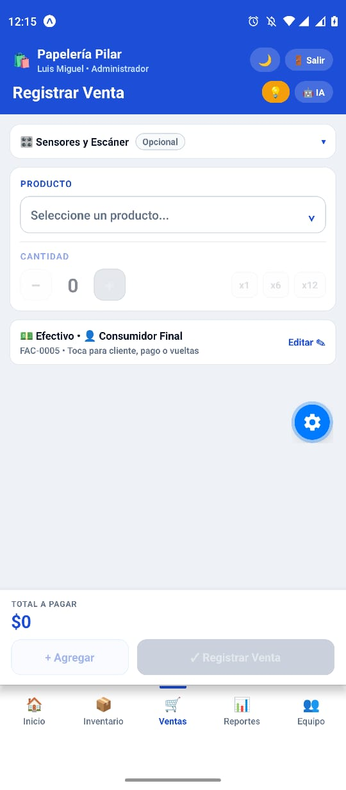
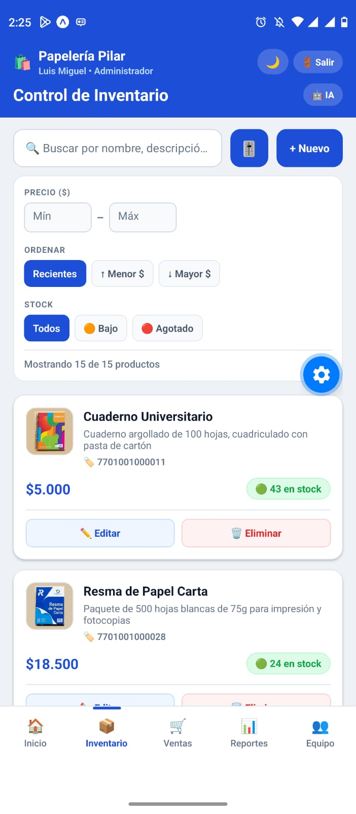
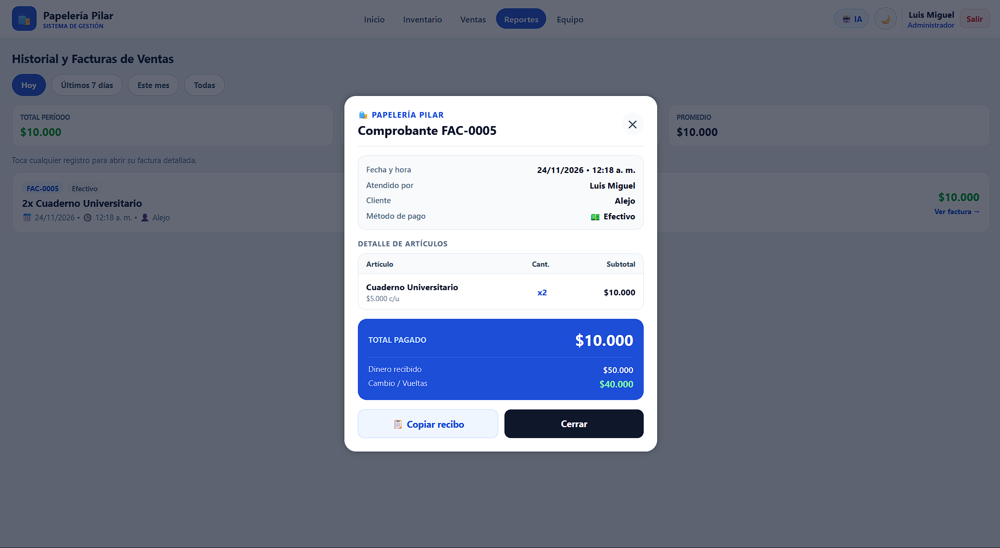
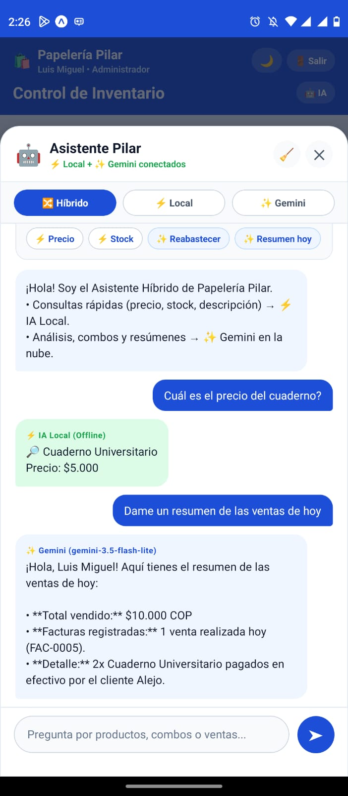

<div align="center">

# 🛍️ Papelería Pilar — POS, Inventario en Tiempo Real e IA Híbrida

**Aplicación multiplataforma (Android, iOS y Web) para la gestión integral de ventas, inventario visual, control de acceso por roles y analítica asistida por inteligencia artificial.**

### 🌐 [Abrir Demo en Vivo (Firebase Hosting)](https://papeleria-pilar.web.app)


</div>

---

## 📌 Sobre el Proyecto

**Papelería Pilar** resuelve los cuellos de botella operativos de una papelería tradicional: falta de visibilidad del stock real, cierres de caja lentos, ausencia de trazabilidad por empleado y errores manuales al facturar en mostrador.

La aplicación opera simultáneamente en **Web (desplegada en Firebase Hosting)** y en **dispositivos móviles (Android/iOS mediante Expo Go)**, sincronizando inventario, facturas y usuarios en tiempo real con **Cloud Firestore** y manteniendo soporte de respaldo *offline* con **AsyncStorage**.

---

## 📸 Capturas de Pantalla

### Vista Web / Escritorio y Autenticación en Modo Oscuro
| Punto de Venta / Inventario (Web) | Login con Google y Modo Oscuro |
| :---: | :---: |
|  |  |

### Experiencia Móvil (Expo Go) y Módulos Principales
| POS Móvil (Sin Scroll) | Inventario Visual | Facturas y Reportes | Asistente IA Híbrido |
| :---: | :---: | :---: | :---: |
|  |  |  |  |

---

## ✨ Funcionalidades Principales

- **🔐 Autenticación Híbrida y Control de Roles (RBAC):**
  - **Acceso con Google (Web):** Cualquier usuario puede ingresar desde la demo en Firebase Hosting con su cuenta de Google; el sistema lo registra automáticamente en Firestore con rol **Vendedor**, permitiendo probar ventas con su nombre real.
  - **Cuentas internas (Usuario/Contraseña):** Gestión completa de credenciales para operar en mostrador o administración desde móvil y web.
  - **Administrador:** Control total de inventario (CRUD), ventas, reportes globales del equipo y administración de usuarios (crear, editar, activar/desactivar cuentas de Google o locales y eliminar).
  - **Vendedor:** Registro de ventas en mostrador, consulta de precios/stock en modo solo lectura y acceso exclusivo a sus propias facturas.
- **📦 Inventario Visual Inteligente:** Catálogo con fotografías reales (galería, cámara o URL), códigos de barras EAN-13, búsqueda multicampo, filtros por rango de precio/stock y semáforo automático (`🟢 Disponible`, `🟠 Stock bajo ≤ 5`, `🔴 Agotado`).
- **🛒 Punto de Venta (POS) Adaptativo:**
  - **Web / Tableta:** Interfaz de 2 columnas con resumen en vivo.
  - **Teléfono:** Diseño compacto con barra inferior fija (`Total` + `+ Agregar` + `✓ Cobrar`) que permite registrar ventas multi-producto **sin hacer scroll**.
  - Validación estricta contra sobregiro de stock, bloqueo de artículos agotados, múltiples métodos de pago (Efectivo, Transferencia, Tarjeta) y calculadora automática de vueltas.
- **🧾 Facturación y Reportes Financieros:** Filtros temporales (*Hoy*, *Últimos 7 días*, *Este mes*, *Todas*), métricas de ingresos/promedio, comprobantes detallados (`FAC-0001`) con trazabilidad del vendedor y opción de copiar o compartir recibos.
- **📷 Escáner Real y Sensores de Hardware:** Lectura de códigos de barras/QR con cámara trasera (en Ventas e Inventario) y gestos con acelerómetro (inclinar para ajustar cantidades y sacudir para limpiar) en Expo Go, más modo simulación para PC/Web.
- **🌓 Modo Claro y Oscuro:** Motor global de temas (`TemaContext`) con persistencia local en el dispositivo.

---

## 🏗️ Decisiones de Arquitectura

### 1. Ecosistema Firebase (Tiempo Real + Auth + Hosting) y Respaldo Offline
- **Cloud Firestore (`onSnapshot` y `writeBatch`):** Sincroniza en tiempo real `productos`, `ventas` y `usuarios` entre navegadores y Expo Go. Al cobrar una factura, el registro de la venta y el descuento de stock se ejecutan en una sola transacción atómica (`writeBatch`). En móvil se habilita `experimentalForceLongPolling` para estabilidad en Expo Go.
- **Firebase Authentication (Web):** `authGoogleService.js` habilita `GoogleAuthProvider` únicamente en plataforma Web (`Platform.OS === "web"`), evitando conflictos de persistencia en Expo Go y aprovisionando cuentas `vendedor` en Firestore mediante `obtenerOCrearUsuarioGoogle`.
- **Firebase Hosting:** Sirve la compilación estática generada por Expo Web (`dist/`) con dominio HTTPS autorizado directamente para Google Auth.
- **AsyncStorage (*Offline-First*):** Respalda sesión, tema y colecciones localmente para mantener operativa la consulta del catálogo ante cortes de red.

### 2. Arquitectura de IA Híbrida (Modelo Local 1-NN + Google Gemini)
El **Asistente Pilar** combina dos motores con selector manual (`🔀 Híbrido`, `⚡ Local`, `✨ Gemini`):

```text
Pregunta del usuario
        │
        ▼
┌─────────────────────────────────────────┐
│  Capa 1: Modelo Local 1-NN (Offline)    │
│  • Tokenización + Similitud de Ochiai   │
│  • Detección automática de producto     │
└───────────────────┬─────────────────────┘
                    │
     ┌──────────────┴──────────────┐
     ▼ (Precio, stock, ficha)      ▼ (Análisis, combos, reportes, consulta abierta)
⚡ Respuesta instantánea      ┌─────────────────────────────────────────┐
   (0 ms, sin internet,       │  Capa 2: Google Gemini REST API (Nube)  │
    costo $0)                 │  • Contexto real de inventario y ventas │
                              │  • Historial conversacional + fallback  │
                              └─────────────────────────────────────────┘
```

---

## 🛠️ Stack Tecnológico y Paquetes

- **Lenguaje:** JavaScript (ES6+)
- **Framework:** React Native + Expo (Android, iOS y Web)
- **Estado y UI:** React Hooks, Context API (`TemaContext`) y diseño adaptativo con `useWindowDimensions`

| Paquete / Servicio | Propósito en el proyecto |
| :--- | :--- |
| `expo` & `react-native` | Base multiplataforma, ejecución en Expo Go y exportación estática para Web. |
| `firebase` | Cloud Firestore (datos en tiempo real + `writeBatch`) y Firebase Auth (Google Sign-In en Web). |
| **Firebase Hosting** | Despliegue en producción de la aplicación Web (`dist/`). |
| `@react-native-async-storage/async-storage` | Persistencia local de sesión, preferencia de tema y caché offline. |
| `expo-camera` | Cámara trasera y escáner real de códigos de barras (`EAN-13`, `EAN-8`, `Code128`, `QR`). |
| `expo-sensors` | Integración con el acelerómetro del dispositivo para gestos de inclinación y sacudida. |
| `expo-image-picker` | Carga de imágenes desde galería o cámara para el catálogo de productos. |
| **Google Gemini API (`fetch`)** | Consumo directo por API REST sin SDKs pesados, con respaldo automático de modelos. |

---

## 📂 Estructura del Proyecto

```text
papeleria-pilar-app/
├── App.js                        # Orquestador global, sesión, permisos y sincronización
├── index.js                      # Punto de entrada de Expo
├── app.json                      # Configuración de Expo (nombre, íconos, permisos)
├── metro.config.js               # Configuración del bundler Metro
├── firebase.json                 # Configuración de despliegue en Firebase Hosting (dist/)
├── .firebaserc                   # Proyecto vinculado de Firebase
├── .env.example                  # Plantilla segura de variables de entorno
├── LICENSE                       # Licencia del proyecto
├── assets/                       # Íconos y fotografías optimizadas del catálogo
├── docs/screenshots/             # Capturas utilizadas en este README
└── src/
    ├── components/
    │   ├── ventas/
    │   │   ├── PanelSensores.js  # Escáner de códigos y gestos de acelerómetro
    │   │   ├── ResumenVenta.js   # Carrito, totales, pago y vueltas
    │   │   └── SelectorProducto.js
    │   ├── AsistenteIA.js        # Chat conversacional con IA Híbrida
    │   ├── ImagenProducto.js     # Render seguro de fotos locales, galería y URLs
    │   ├── ModalFactura.js       # Comprobante detallado y compartir/copiar recibo
    │   ├── ModalGuiaSensores.js  # Guía interactiva de gestos y escáner
    │   ├── ModalMensaje.js       # Diálogos de confirmación y alertas propias
    │   └── NavegacionAdaptativa.js
    ├── context/
    │   └── TemaContext.js        # Paletas de Modo Claro y Oscuro persistentes
    ├── data/
    │   ├── catalogoPapeleria.js  # 15 productos iniciales con EAN-13 y precios en COP
    │   └── usuariosIniciales.js  # Cuentas semilla (Admin y Vendedor)
    ├── screens/
    │   ├── PantallaInventario.js # CRUD, filtros, fotos y escáner de códigos
    │   ├── PantallaLogin.js      # Login con credenciales y botón de Google (Web)
    │   ├── PantallasGestion.js   # Dashboard de Inicio y Reportes por período
    │   ├── PantallaUsuarios.js   # Gestión de equipo y roles (exclusivo Admin)
    │   └── PantallaVentas.js     # Punto de venta adaptativo (Web 2 cols / Móvil sin scroll)
    ├── services/
    │   ├── authGoogleService.js  # Flujo de inicio y cierre de sesión con Google en Web
    │   ├── firebaseConfig.js     # Inicialización de Firebase (Firestore + Auth solo Web)
    │   ├── firestoreService.js   # CRUD, listeners en vivo, writeBatch y alta de Google
    │   ├── geminiService.js      # Cliente REST de Google Gemini con contexto de negocio
    │   └── modeloIA.js           # Clasificador local 1-NN (coeficiente de Ochiai)
    └── utils/
        ├── fechaHelpers.js       # Formateo local y filtrado por períodos
        ├── permisos.js           # Matriz de control de acceso por rol (RBAC)
        └── stockHelpers.js       # Reglas y semáforo visual de inventario
```

---

## 🚀 Instalación, Ejecución y Despliegue

### 1. Clonar el repositorio e instalar dependencias
```bash
git clone [https://github.com/LuisMiguelC01/papeleria-pilar-app.git](https://github.com/LuisMiguelC01/papeleria-pilar-app.git)
cd papeleria-pilar-app
npm install
```

### 2. Configurar variables de entorno
Duplica `.env.example`, renómbralo a `.env` y completa tus credenciales de Firebase y Google AI Studio:
```bash
cp .env.example .env
```
> Si omites `.env`, la aplicación arranca en modo local (`AsyncStorage` + `⚡ IA Local 1-NN`).

### 3. Ejecutar en desarrollo
```bash
npx expo start -c
```
- Presiona **`w`** para abrir la versión Web (incluye inicio de sesión con Google).
- Escanea el código QR con **Expo Go** en Android o iOS para probar escáner de códigos de barras y acelerómetro.

### 4. Compilar y desplegar en Firebase Hosting
```bash
npx expo export --platform web -c
firebase deploy --only hosting
```

### 🔑 Acceso de prueba
| Método / Rol | Acceso | Permisos |
| :--- | :--- | :--- |
| 🧑‍💼 **Vendedor (Demo Web)** | Botón **Continuar con Google** | Ventas en mostrador, consulta de inventario y sus propios reportes |
| 👑 **Administrador (Local)** | `admin` / `1234` *(configurable en Equipo)* | Control total de inventario, ventas, reportes globales y gestión de usuarios |

---

## 👥 Equipo y Contribuciones

| Integrante | Rol | Aporte | Responsabilidades Principales |
| :--- | :--- | :---: | :--- |
| **Luis Miguel Canchimbo Gómez** | Líder Técnico y Desarrollador Principal | **80%** | Arquitectura, desarrollo completo (React Native / Expo), integración con Firebase (Firestore, Auth, Hosting), IA híbrida (1-NN + Gemini) y despliegue. |
| **Yiseth Alejandra Cuetia Indo** | Pruebas (QA) y Documentación | **10%** | Pruebas funcionales en dispositivos, validación de flujos de usuario y apoyo en documentación. |
| **Elkin Stiven Casierra Cuero** | Pruebas (QA) y Documentación | **10%** | Pruebas funcionales, verificación de escenarios de venta/inventario y apoyo en documentación. |

[](https://github.com/LuisMiguelC01)
[](https://www.linkedin.com/in/luis-miguel-canchimbo/)

