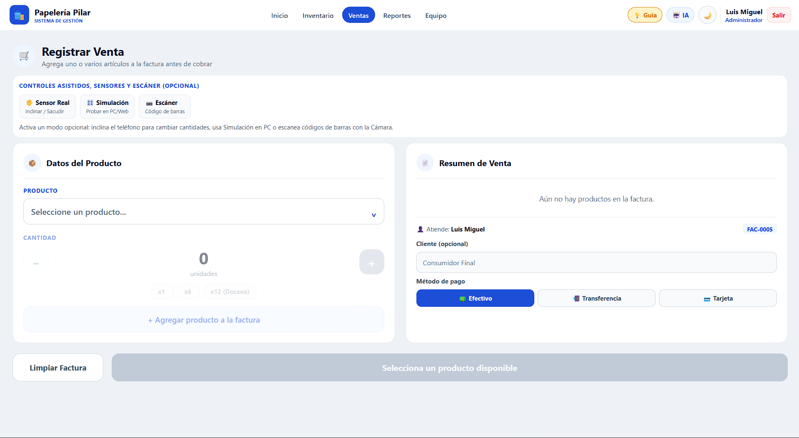
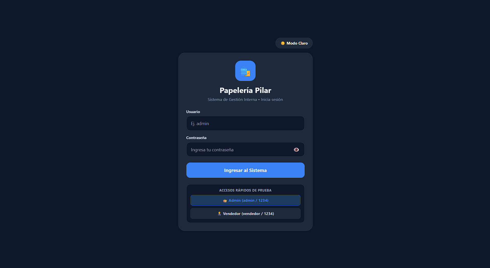

<div align="center">

# 🛍️ Papelería Pilar — POS, Inventario en Tiempo Real e IA Híbrida

**Aplicación multiplataforma (Android, iOS y Web) para la gestión integral de ventas, inventario visual, control de roles y analítica asistida por inteligencia artificial.**


</div>

---

## 📌 Sobre el Proyecto

**Papelería Pilar** nació para resolver los cuellos de botella operativos de una papelería tradicional: falta de visibilidad del stock real, cierres de caja lentos, ausencia de trazabilidad por empleado y errores manuales al facturar en mostrador.

La aplicación permite operar el negocio desde el computador (Web/Tableta) y desde el celular (Android/iOS con Expo Go) de forma simultánea, sincronizando cada venta y cambio de inventario en tiempo real con **Cloud Firestore** y manteniendo soporte de respaldo offline mediante **AsyncStorage**.

---

## 📸 Capturas de Pantalla

### Vista de Escritorio / Web y Modo Oscuro
| Punto de Venta / Inventario (Web) | Login y Modo Oscuro |
| :---: | :---: |
|  |  |

### Experiencia Móvil (Expo Go) y Módulos Clave
| POS Móvil (Sin Scroll) | Inventario Visual | Facturas y Reportes | Asistente IA Híbrido |
| :---: | :---: | :---: | :---: |
|  |  |  |  |

---

## ✨ Funcionalidades Principales

- **🔐 Autenticación y Control de Roles (RBAC):** Inicio de sesión con usuario/contraseña y matriz de permisos:
  - **Administrador:** Control total de inventario (CRUD), ventas, reportes globales del equipo y administración de cuentas de vendedores (crear, editar, activar/desactivar y eliminar).
  - **Vendedor:** Registro de ventas en mostrador, consulta de precios/stock en modo solo lectura y acceso exclusivo a sus propias facturas.
- **📦 Inventario Visual Inteligente:** Catálogo con fotografías reales (galería, cámara o URL), códigos de barras EAN-13, búsqueda multicampo, filtros por rango de precio/stock y semáforo automático (`🟢 Disponible`, `🟠 Stock bajo ≤ 5`, `🔴 Agotado`).
- **🛒 Punto de Venta (POS) Adaptativo:**
  - En **Web/Tableta:** Interfaz de 2 columnas con resumen en vivo.
  - En **Teléfono:** Diseño compacto con barra inferior fija (`Total` + `+ Agregar` + `✓ Cobrar`) que permite registrar ventas multi-producto **sin hacer scroll**.
  - Validación estricta de sobregiro de stock, bloqueo de artículos agotados, múltiples métodos de pago (Efectivo, Transferencia, Tarjeta) y calculadora automática de vueltas.
- **🧾 Facturación y Reportes Financieros:** Filtros temporales (*Hoy*, *Últimos 7 días*, *Este mes*, *Todas*), métricas de ingresos/promedio, comprobantes detallados (`FAC-0001`) y opción de copiar o compartir recibos.
- **📷 Escáner Real y Sensores de Hardware:** Lectura real de códigos de barras/QR con cámara trasera (en Ventas e Inventario) y gestos con acelerómetro (inclinar para ajustar cantidades y sacudir para limpiar), más modo simulación para PC/Web.
- **🌓 Modo Claro y Oscuro:** Motor global de temas (`TemaContext`) persistido localmente en el dispositivo.

---

## 🏗️ Decisiones de Arquitectura

### 1. Integración con Firebase (Nube en Tiempo Real + Caché Offline)
La persistencia combina **Cloud Firestore** con **AsyncStorage** bajo un enfoque *offline-first*:
- **Suscripciones en vivo (`onSnapshot`):** Las colecciones `productos`, `ventas` y `usuarios` se sincronizan automáticamente entre Web y dispositivos móviles sin recargar.
- **Integridad transaccional (`writeBatch`):** Al cobrar una factura, el registro de la venta y el descuento de stock de todos los artículos se ejecutan en una sola operación atómica.
- **Resiliencia:** Cada actualización de la nube se respalda en `AsyncStorage`, permitiendo consultar el catálogo y operar incluso ante cortes temporales de internet. En Expo Go se habilita `experimentalForceLongPolling` para garantizar estabilidad de conexión en Android/iOS.

### 2. Arquitectura de IA Híbrida (Modelo Local 1-NN + Google Gemini)
El **Asistente Pilar** integra dos motores complementarios con selector manual (`🔀 Híbrido`, `⚡ Local`, `✨ Gemini`):

```text
Pregunta del usuario
        │
        ▼
┌─────────────────────────────────────────┐
│  Capa 1: Modelo Local 1-NN (Offline)    │
│  • Tokenización + Similitud de Ochiai   │
│  • Detección automática de producto     │
└───────────────────┬─────────────────────┘
                    │
     ┌──────────────┴──────────────┐
     ▼ (Precio, stock, ficha)      ▼ (Análisis, combos, reportes, consulta abierta)
⚡ Respuesta instantánea      ┌─────────────────────────────────────────┐
   (0 ms, sin internet,       │  Capa 2: Google Gemini REST API (Nube)  │
    costo $0)                 │  • Contexto real de inventario y ventas │
                              │  • Historial conversacional + fallback  │
                              └─────────────────────────────────────────┘
```

- **Ventaja técnica:** Evita llamadas innecesarias a la API para consultas simples de mostrador (latencia ~0 ms y 100% funcional sin internet), reservando la potencia generativa de **Gemini** para recomendaciones de reabastecimiento, resúmenes diarios y armado de combos según presupuesto real.

---

## 🛠️ Stack Tecnológico y Paquetes

- **Lenguaje:** JavaScript (ES6+)
- **Framework:** React Native + Expo (SDK multiplataforma Android / iOS / Web)
- **Estilos y Estado:** React Hooks, Context API (`TemaContext`) y diseño responsivo con `useWindowDimensions`

| Paquete / Servicio | Propósito en el proyecto |
| :--- | :--- |
| `expo` & `react-native` | Base multiplataforma y ejecución simultánea en Web y Expo Go. |
| `firebase` | Conexión a Cloud Firestore (`onSnapshot`, `writeBatch`, `setDoc`, `query`). |
| `@react-native-async-storage/async-storage` | Persistencia local de sesión, preferencia de tema y caché offline. |
| `expo-camera` | Cámara trasera y escáner real de códigos de barras (`EAN-13`, `EAN-8`, `Code128`, `QR`). |
| `expo-sensors` | Integración con el acelerómetro del dispositivo para control por gestos. |
| `expo-image-picker` | Carga de imágenes desde galería o cámara para el catálogo de productos. |
| **Google Gemini API (`fetch`)** | Consumo directo por API REST sin dependencias pesadas, con respaldo automático de modelos. |

---

## 📂 Estructura del Proyecto

```text
papeleria-pilar/
├── App.js                        # Orquestador global, sesión, permisos y sincronización
├── .env.example                  # Plantilla segura de variables de entorno
├── assets/productos/             # 15 fotografías optimizadas del catálogo
├── docs/screenshots/             # Capturas utilizadas en este README
└── src/
    ├── context/
    │   └── TemaContext.js        # Paletas de Modo Claro y Oscuro persistentes
    ├── data/
    │   ├── catalogoPapeleria.js  # 15 productos iniciales con EAN-13 y precios en COP
    │   └── usuariosIniciales.js  # Cuentas base (Admin y Vendedor)
    ├── screens/
    │   ├── PantallaLogin.js      # Inicio de sesión y accesos rápidos de prueba
    │   ├── PantallaVentas.js     # Punto de venta adaptativo (Web 2 cols / Móvil sin scroll)
    │   ├── PantallaInventario.js # CRUD, filtros, fotos y escáner de códigos
    │   ├── PantallasGestion.js   # Dashboard de Inicio y Reportes por período
    │   └── PantallaUsuarios.js   # Gestión de equipo y roles (exclusivo Admin)
    ├── components/
    │   ├── NavegacionAdaptativa.js
    │   ├── AsistenteIA.js        # Chat conversacional con IA Híbrida
    │   ├── ModalFactura.js       # Comprobante detallado y compartir/copiar recibo
    │   ├── ModalGuiaSensores.js  # Guía interactiva de gestos y escáner
    │   ├── ModalMensaje.js       # Diálogos de confirmación y alertas propias
    │   ├── ImagenProducto.js     # Render seguro de fotos locales, galería y URLs
    │   └── ventas/               # PanelSensores, SelectorProducto, ResumenVenta
    ├── services/
    │   ├── firebaseConfig.js     # Inicialización de Firebase con soporte Expo Go/Web
    │   ├── firestoreService.js   # Operaciones CRUD, listeners en vivo y writeBatch
    │   ├── modeloIA.js           # Clasificador local 1-NN (coeficiente de Ochiai)
    │   └── geminiService.js      # Cliente REST de Google Gemini con contexto de negocio
    └── utils/
        ├── permisos.js           # Matriz de control de acceso por rol (RBAC)
        ├── stockHelpers.js       # Reglas y semáforo visual de inventario
        └── fechaHelpers.js       # Formateo local y filtrado por períodos
```

---

## 🚀 Instalación y Ejecución Local

### 1. Clonar el repositorio e instalar dependencias
```bash
git clone [https://github.com/TU-USUARIO/papeleria-pilar-app.git](https://github.com/TU-USUARIO/papeleria-pilar-app.git)
cd papeleria-pilar-app
npm install
```

### 2. Configurar variables de entorno
Duplica `.env.example`, renómbralo a `.env` y completa tus credenciales de Firebase (Firestore) y Google AI Studio (Gemini):
```bash
cp .env.example .env
```
> **Nota:** Si omites las variables de `.env`, la aplicación arranca igualmente en modo local (`AsyncStorage` + `⚡ IA Local 1-NN`).

### 3. Iniciar la aplicación
```bash
npx expo start -c
```
- Presiona **`w`** para abrir la versión Web en tu navegador.
- Escanea el código QR con **Expo Go** en Android o iOS para probar sensores, cámara y vista móvil.

### 🔑 Credenciales de demostración
| Rol | Usuario | Contraseña | Permisos |
| :--- | :--- | :--- | :--- |
| 👑 **Administrador** | `admin` | `1234` | Acceso total (Inventario, Ventas, Reportes globales y Equipo) |
| 🧑‍💼 **Vendedor** | `vendedor` | `1234` | Ventas en mostrador, consulta de inventario y sus propios reportes |

---

## 👨‍💻 Autor

**Luis Miguel Canchimbo Gómez**  
Estudiante de Ingeniería de Sistemas — Desarrollo Multiplataforma, Cloud e Integración de IA.

[](https://github.com/TU-USUARIO)
[](https://linkedin.com/in/TU-LINKEDIN)